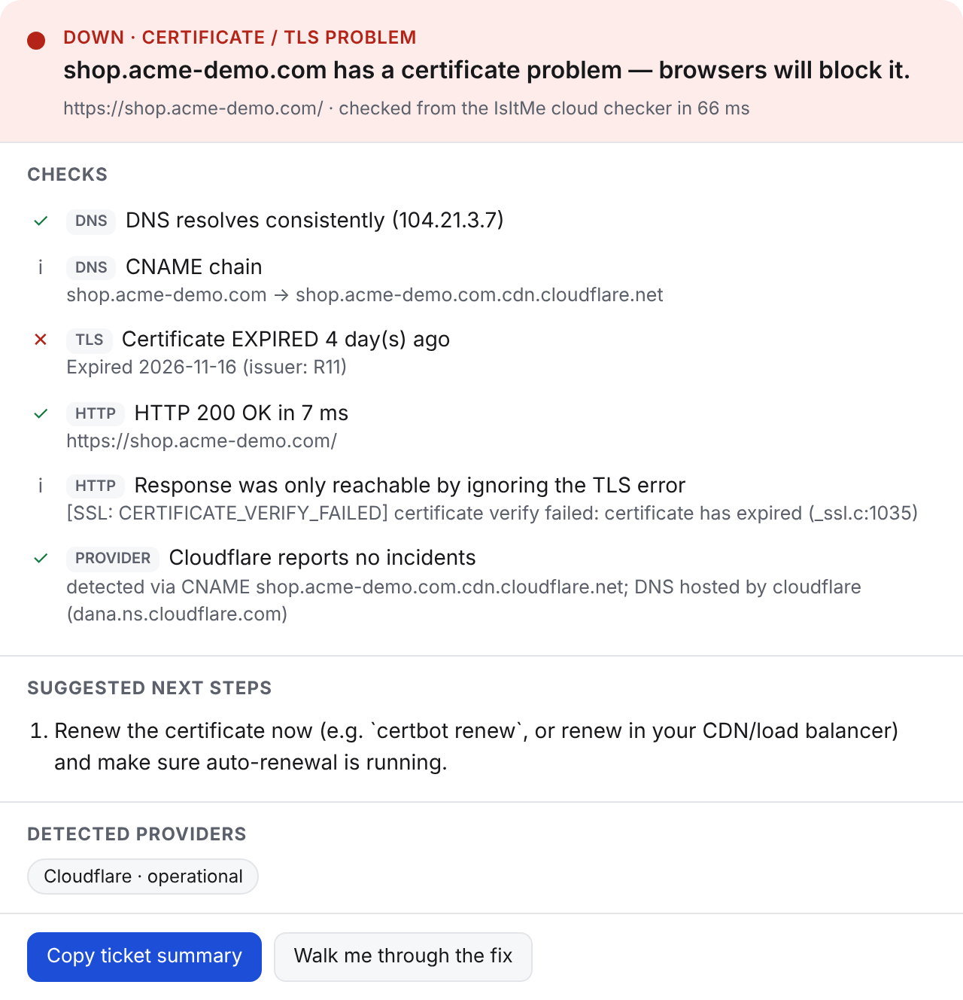

<!-- mcp-name: io.github.arun250492/Personal-MCP -->

# Personal MCP + IsItMe?

An MCP server that does two jobs:

1. **IsItMe? — outage triage for IT people.** "Is it down, or is it just me?" One call checks DNS, the TLS
   certificate, the HTTP response and the hosting provider's status page, then returns a verdict, the likely cause,
   next steps and a ticket-ready summary. Also available as a **ChatGPT app**.
2. **Personal desktop assistant.** Files, shell, clipboard, screenshots, apps, Gmail, Google Calendar,
   notifications and more — for Claude Desktop, Claude Code and other local MCP clients.



## Install

```bash
pip install personal-mcp-arun            # core + IsItMe? triage tools
pip install "personal-mcp-arun[all]"     # + Gmail/Calendar, desktop (psutil, clipboard, screenshots), Twitter/X
```

Python 3.10+. Requires the MCP Python SDK 2.x (installed automatically).

### Claude Desktop / Claude Code

```json
{
  "mcpServers": {
    "personal": { "command": "personal-mcp" }
  }
}
```

Claude Code: `claude mcp add personal -- personal-mcp`

## IsItMe? triage tools

| Tool | What it does |
|---|---|
| `diagnose(url)` | One-shot outage diagnosis with a verdict card: DNS + TLS + HTTP + provider status, likely cause, fixes, ticket summary |
| `check_dns(name, record_types)` | A/AAAA/CNAME/MX/TXT/NS/CAA/SOA from Google + Cloudflare DNS (and your own resolver locally), consistency check |
| `check_tls(url)` | Certificate expiry, hostname match, issuer, chain trust, protocol |
| `check_http(url)` | Status, redirect chain, latency, CDN headers, explanations of 5xx / Cloudflare 52x |
| `check_email_auth(domain)` | MX, SPF (incl. 10-lookup limit), DMARC policy, DKIM under common selectors |
| `vendor_status(vendors)` | Live status of AWS, Azure, GCP, Cloudflare, GitHub, Slack, Jira, Zoom, Vercel, Netlify, OpenAI, … |

**Local vs. cloud view.** Run locally, the checks run from *your* network (and can reach internal hosts). Set
`PERSONAL_MCP_CLOUD_URL=https://<your-hosted-isitme>` and call `diagnose(url, compare_cloud=true)` to also run them
from the internet — if it works from the cloud but not from you, the verdict is "your network".

## Personal assistant tools

System info, IP addresses, disk usage, port check, shell commands · list/read/write/search/move/delete files ·
clipboard, screenshots · open URLs, web search, fetch URL · open apps, list/kill processes · Gmail inbox/read/send ·
Calendar today/upcoming/create · notifications, reminders · Twitter/X post · date/time, calculator, text-to-speech.

**Safe mode:** set `PERSONAL_MCP_SAFE_MODE=1` to not register tools that run commands, write/move/delete files,
kill processes, send e-mail or post to social media.

Gmail/Calendar: put a Google OAuth *Desktop app* client file at `~/.personal-mcp/gmail_credentials.json`
(or set `GMAIL_CREDENTIALS_PATH`). The first call opens a browser to sign in.

## Run modes

```bash
personal-mcp             # stdio (default) — all tools
personal-mcp --http      # streamable HTTP on 127.0.0.1:8000 — all tools, local clients only
personal-mcp --hosted    # public server on 0.0.0.0:$PORT — ONLY the read-only IsItMe? tools
```

`--hosted` is what powers the ChatGPT app. It never registers personal tools, only checks public internet
addresses on ports 80/443/8080/8443 (private, loopback, link-local and cloud-metadata addresses are refused, and
every connection is pinned to a verified IP to stop DNS-rebinding), rate-limits per client, caches results for 60 s
and logs no checked URLs. Deploy with the included `Dockerfile` (see [PUBLISHING.md](PUBLISHING.md)).

## Development

```bash
pip install -e ".[dev]"
pytest -q
```

Tests spin up local HTTPS servers with valid, expiring, expired, wrong-host and self-signed certificates, and
exercise the MCP protocol in-process, over streamable HTTP and over stdio.

## License

MIT © Arun
